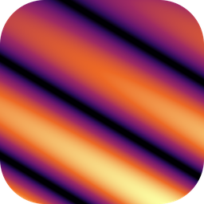
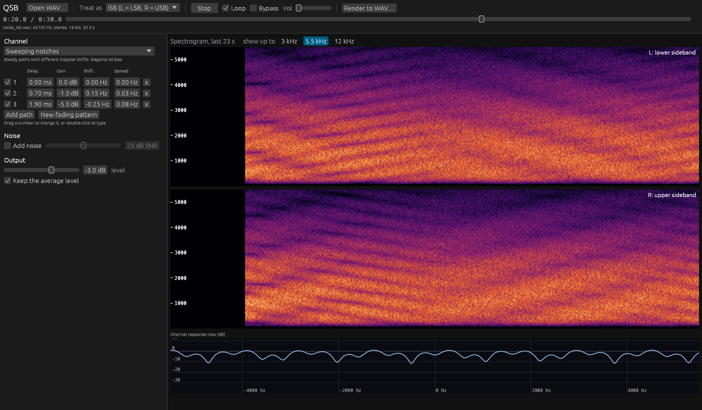

# QSB

QSB is the Q-code for "your signal is fading".

Puts a WAV file through a simulated HF radio channel: echoes, Doppler shift, fading
and noise, from light slow fading to heavy multipath. You hear and see the result
while you move the controls, then write it to a new WAV.



## Using it

1. Open a WAV (or drop one on the window). Mono or stereo, any rate, 8 to 32 bit.
2. For a stereo file, pick what the two channels are:
   - **Audio (SSB)**: two audio channels, faded alike.
   - **I/Q**: left is I, right is Q.
   - **ISB**: left is the lower sideband and right the upper of one carrier (KiwiSDR
     ISB recordings). Both fade as one RF channel, so the notches run opposite ways.
3. Pick a preset, press **Play**, and change the paths as it plays.
4. **Render to WAV…** writes the whole file, in the input's format, lined up with it.

Each path has:

| | |
|---|---|
| Delay | how late the path arrives, 0 to 40 ms |
| Gain | its strength |
| Shift | Doppler shift: the whole path moved in frequency |
| Spread | Doppler spread: how fast the path fades. 0 is a steady path |

Two steady paths with different shifts give notches that sweep across the band at
(shift difference ÷ delay difference) Hz a second: the diagonal stripes of real
recordings. Spread adds the random fading on top.

**New fading pattern** gives another random run of the same channel. The rendered
file uses the same settings as the preview but starts its fading from the beginning,
so it is not sample-for-sample what you just heard.

## Presets

Clean, light slow fading, slow selective fading, sweeping notches, intense
multipath, auroral flutter, and the ITU-R F.1487 Annex 3 test channels (two equal
fading paths; low, mid and high latitudes; quiet, moderate and disturbed). The ITU
figures are as usually quoted: check them against the Recommendation before quoting
modem results from them.

## The model

A tapped delay line after Watterson (Watterson, Juroshek and Bensema, 1970; the
model of ITU-R F.1487 Annex 1). Each fading path is multiplied by a complex Gaussian
process with a Gaussian Doppler spectrum (Rayleigh fading); "spread" is twice that
spectrum's standard deviation. Real audio is made analytic first, so a shift moves
all frequencies alike, as at RF. Noise is white, with the SNR figured in 3 kHz
against the file's average level.

## Command line

```
qsb [FILE.wav] [--preset NAME] [--mode audio|iq|isb] [--seed N] [--play] [--mute]
qsb --render IN.wav OUT.wav [--preset NAME] [--mode M] [--seed N] [--snr DB]
qsb --spectrogram IN.wav OUT.png [--mode M]
```

## Building

```
cargo build --release
powershell -ExecutionPolicy Bypass -File scripts\build-portable.ps1
```

The second makes a portable `exe\qsb.exe` (nothing to install).

GPL-3.0-or-later.
